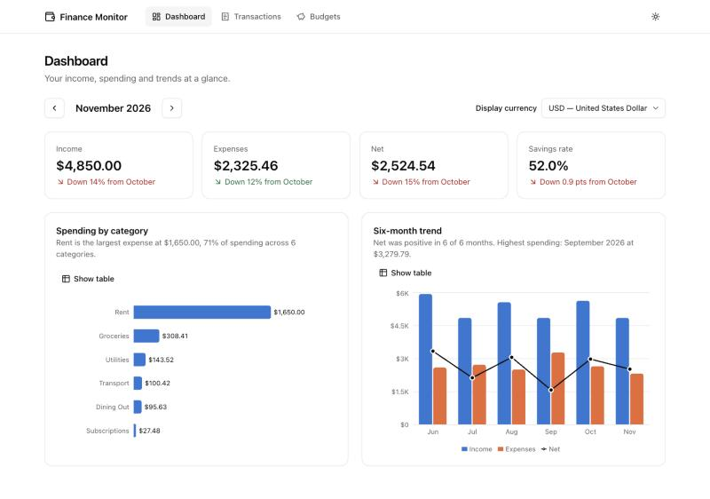
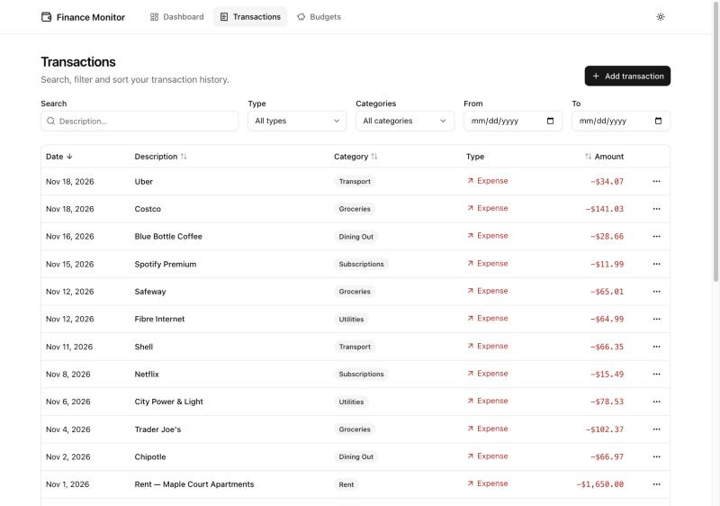
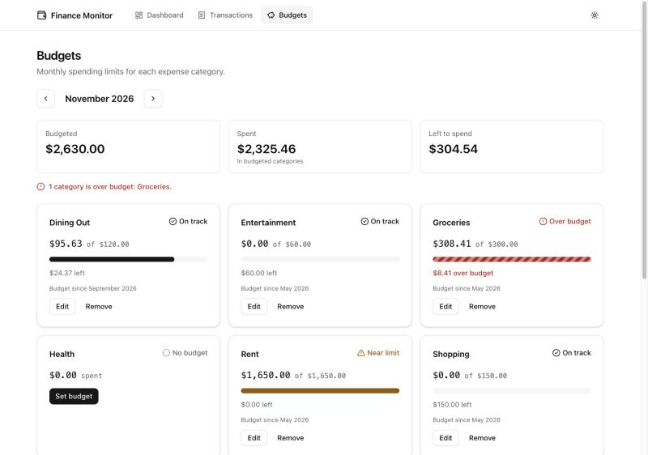
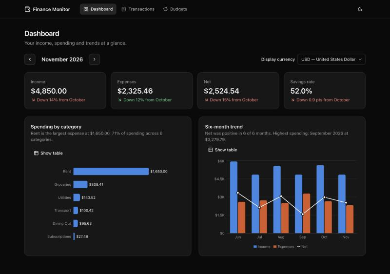
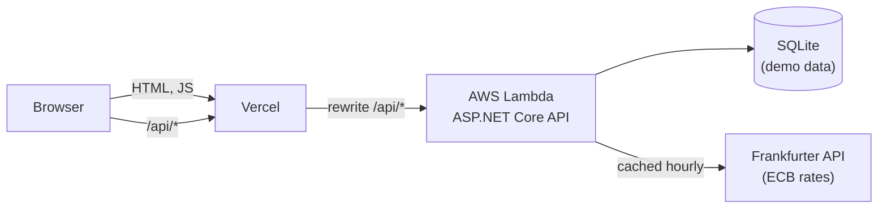

# Finance Monitor

A personal finance dashboard: track transactions, set monthly budgets, and see where the money goes, in any of 30 currencies.

**React 19 + TypeScript** on the front end, **ASP.NET Core (.NET 11)** on the back end, deployed to **Vercel** and **AWS Lambda**.

**Live demo:** _https://REPLACE-ME.vercel.app_ · **API docs:** _https://REPLACE-ME.vercel.app/api/docs_

> The demo runs on sample data that resets from time to time, so feel free to add, edit and delete.



| Transactions | Budgets | Dark theme |
| --- | --- | --- |
|  |  |  |

## Features

- **Transactions:** search, filter (type, several categories, date range), sort and page through history. Every view is a URL, so filtered views can be shared and survive a refresh.
- **Add, edit and delete** in dialogs that are real routes (Back closes them, an edit link can be shared), with **optimistic updates** and rollback.
- **Budgets:** a monthly limit per category, with progress bars and on-track / near-limit / over-budget status. Budgets are **effective-dated**, so changing one never rewrites past months.
- **Dashboard:** income, expenses, net and savings rate with month-on-month change, spending by category, and a six-month trend. Every chart has a text summary and a table view.
- **Multi-currency display:** pick any of 30 currencies; amounts are converted on the server at the latest European Central Bank rate, with the rate and its date shown.
- **Accessible:** keyboard navigable, screen-reader labelled, light and dark themes that meet WCAG AA contrast, and never colour alone to convey meaning.

## Tech stack

| | |
| --- | --- |
| **Web** | Vite, React 19, TypeScript (strict), TanStack Router (file-based, Zod-validated search params), TanStack Query, TanStack Table v9, React Hook Form + Zod, Recharts, Tailwind CSS v4 + shadcn/ui |
| **API** | ASP.NET Core minimal APIs (.NET 11) in the REPR pattern, EF Core + SQLite, built-in validation, OpenAPI + Scalar, `HttpClient` + resilience handlers |
| **Testing** | Vitest + React Testing Library + MSW, axe-core · xUnit v3 + AwesomeAssertions + NSubstitute, `WebApplicationFactory` |
| **Delivery** | GitHub Actions CI, AWS Lambda (SAM, arm64), Vercel |

## Architecture



The browser only ever talks to one origin: Vercel serves the app and forwards `/api/*` to the Lambda function, the same way the Vite dev server proxies to the API locally. No CORS configuration is needed anywhere.

```
web/        React app, organised by feature (features/transactions, budgets, dashboard)
api/        ASP.NET Core API: one file per endpoint under Features/, tests under tests/
fixtures/   Test cases shared by BOTH test suites (money conversion, budget status)
infra/      AWS SAM template for the Lambda deployment
```

## Getting started

Prerequisites: **Node.js 22+**, **pnpm 11**, and the **.NET SDK 11.0.100** (pinned in `global.json`).

```bash
pnpm install
dotnet tool restore --tool-manifest api/dotnet-tools.json
pnpm dev
```

- Web: http://localhost:5173
- API: http://localhost:5080, with interactive docs at http://localhost:5080/api/docs

The API creates its SQLite database on first run and seeds about 100 demo transactions covering the last six months, plus budgets. Delete `api/src/FinanceMonitoring.Api/finance.db` to start fresh.

| Command | What it does |
| --- | --- |
| `pnpm dev` | Run the API (`dotnet watch`) and the web app together |
| `pnpm test` | Run the web (Vitest) and API (xUnit) test suites |
| `pnpm check` | Typecheck, lint, format-check and test both apps (what CI runs) |
| `pnpm build` | Production build of both apps |
| `pnpm --filter web gen:api` | Regenerate TypeScript API types from `api/openapi/finance-api.json`, which every API build rewrites |

## Technical decisions

**Money is integer minor units, never floats.** Amounts are stored and sent as cents (or yen, or fils) in a `long`/`number`. Parsing user input ("12.50") goes digit by digit, with no `parseFloat`. Currency conversion uses exact decimal arithmetic (`decimal` in C#, `BigInt` in TypeScript) with a single **round-half-to-even** at the end. Amounts are capped at 2⁵³−1 on the server, the largest integer JavaScript represents exactly.

**One set of test cases, two implementations.** Conversion rounding and budget status thresholds exist in both C# and TypeScript (the TypeScript copies drive optimistic updates). JSON fixtures in `fixtures/` are run by **both** test suites, so the two can never disagree. One case is a real float trap: 50¢ × 1.15 is exactly 57.5, but floats compute 57.49999999999999.

**REPR endpoints (Request, Endpoint, Response).** Each API operation is one file containing its request record, handler and response records ([example](api/src/FinanceMonitoring.Api/Features/Transactions/ListTransactions.cs)). Endpoints are discovered at startup, so adding one never touches `Program.cs`.

**The C# contract is the TypeScript contract.** The API writes its OpenAPI document on build, and the web app's types are generated from it. Rename a C# property and the front end stops compiling; CI fails if the generated types are stale.

**The URL is the state.** Filters, sorting, paging and the selected month live in the URL, validated by Zod schemas that fall back to defaults instead of crashing on hand-edited links. Arrays use repeated keys (`?category=dining&category=groceries`), the same format the API accepts.

**Optimistic updates with honest rollback.** Edits and deletes update every cached list immediately and roll back from a snapshot on failure. Creates show a "Saving…" row instead, because a new row's position in a sorted, filtered page isn't known until the server answers. A failed save never loses what you typed: the dialog reopens with your input and the server's field errors.

**Optimistic concurrency.** Transactions and budgets carry a `version`. Saving from a stale copy returns **409 Conflict** instead of silently overwriting someone else's change; a test reproduces the "two people edit at once" race.

**Effective-dated budgets.** A budget row means "from this month onward", and a month uses the latest row starting on or before it. Raising a budget in November leaves September and October judged against the limits that applied then.

**Currency conversion on the server.** The API converts each figure once from its exact USD value and reports the rate and its ECB date. Rates are cached for an hour (they're published once each working day). If the source is down, the last good rate is served and the UI says it's stale; with no rate at all, the dashboard falls back to USD and explains why. Converting each figure independently means categories can differ from the converted total by a cent or two, as on any FX statement, and the UI says so rather than adjusting a real number.

**Accessibility measured, not assumed.**
- Text colours were measured against WCAG AA (4.5:1) in both themes.
- Chart colours were validated for colour-blind readers: the blue/orange series pair scores a ΔE of 25 against a target of 8. The usual red/green scored 7.1 for deuteranopia, so it's kept only in tables, where +/− signs and labels back it up.
- axe-core runs on every page in the test suite.

**AWS Lambda: self-contained and ReadyToRun, not Native AOT.**
- Lambda has no managed .NET 11 runtime, so the API ships its own (self-contained) on the OS-only `provided.al2023` runtime, on arm64.
- ReadyToRun precompilation cut startup to first response from 0.63 s to 0.35 s in local tests.
- Native AOT would start faster still, but EF Core's AOT support is experimental and can't run the dynamic queries the filters need.

## Testing

| | |
| --- | --- |
| **Web: 290 tests** | Money utilities and parsing; URL schemas; the transaction form (validation messages, focus, submit in cents); URL-driven filtering; optimistic create/edit/delete including rollback and a 409 race; budgets; dashboard; theme; phone layout; axe checks on every page |
| **API: 165 tests** | Every endpoint through `WebApplicationFactory` against in-memory SQLite and a fixed clock; validation and 409s; month boundaries and effective dating; currency conversion against hand-checked values; the rate cache and its fallbacks (NSubstitute); rate limiting |

- **No network in tests.** The front end mocks HTTP at the network level with MSW, so the real client and query code run. The API replaces the exchange-rate source with NSubstitute and canned HTTP responses.
- **Key tests are mutation-checked.** Breaking the behaviour they guard (removing the debounce, the optimistic update, the USD fallback) makes them fail.

## Deployment

### API on AWS Lambda

The API is packaged by `api/scripts/publish-lambda.sh` (self-contained, ReadyToRun, linux-arm64) and deployed with [AWS SAM](https://docs.aws.amazon.com/serverless-application-model/) from `infra/template.yaml`. That creates one Lambda function with a public Function URL and a log group with 14-day retention.

**From your machine** (needs the [AWS CLI](https://docs.aws.amazon.com/cli/latest/userguide/getting-started-install.html) and [SAM CLI](https://docs.aws.amazon.com/serverless-application-model/latest/developerguide/install-sam-cli.html), e.g. `brew install awscli aws-sam-cli`):

```bash
aws login --region ap-southeast-2 --profile finance
```
```bash
api/scripts/publish-lambda.sh
```
```bash
sam deploy --template-file infra/template.yaml --profile finance
```

`aws login` signs in through the browser and issues temporary credentials, so no access keys are stored. The stack name, region and other options come from `infra/samconfig.toml`; SAM shows the changeset and asks before applying it.

**From GitHub Actions:** the **Deploy API** workflow (manual trigger) builds on an arm64 runner, smoke-tests the package, deploys and then checks the live URL. It authenticates with OIDC, so there are no stored AWS keys. One-time setup:

1. In IAM, add GitHub's OIDC identity provider and a role this repository can assume, with permission to deploy the stack (CloudFormation, Lambda, IAM role creation for the function, S3 for SAM artifacts, CloudWatch Logs).
2. Add the repository secret `AWS_DEPLOY_ROLE_ARN` (the role's ARN) and the variable `AWS_REGION` (`ap-southeast-2`, matching `infra/samconfig.toml`).

After deploying, copy the stack's `ApiUrl` output into the `/api` rewrite in `web/vercel.json`.

> **If the Function URL returns 403:** since October 2025, public function URLs need both `lambda:InvokeFunctionUrl` and `lambda:InvokeFunction` in the function's resource policy. SAM adds these, but older templates or manual setups may lack the second. See [Control access to Lambda function URLs](https://docs.aws.amazon.com/lambda/latest/dg/urls-auth.html).

**Cost:** at demo traffic this stays inside Lambda's always-free monthly allowance (1M requests and 400,000 GB-seconds). AWS doesn't cap spending by default, so set up an **AWS Budgets alert** on the account.

### Web on Vercel

1. Import the repository in Vercel and set **Root Directory** to `web`. Vercel reads `web/vercel.json` for the build, the `/api` rewrite, the SPA fallback and the security headers.
2. Add the environment variable `VITE_DEMO_MODE=true` to show the "sample data resets" banner.

## Known limitations

- **The demo database resets.** On Lambda, SQLite lives in the function's temporary storage, so it re-seeds fresh sample data on each cold start, and concurrent instances each have their own copy. A production deployment would use DynamoDB or Aurora; with EF Core, moving to Postgres is a provider change rather than a rewrite.
- **Single user, no sign-in.** Authentication and per-user data are out of scope for the demo.
- **Amounts are stored in USD.** Other currencies are display-only conversions.
- **Rate limiting is best-effort.** It partitions by the forwarded client IP, which a caller hitting the function URL directly could spoof. Real protection would be AWS WAF or API Gateway throttling.
- **No Content Security Policy yet.** The other security headers are set; a CSP needs care with chart and dialog libraries that use inline styles.
- **Cold starts.** The first request after the function has been idle takes a few seconds while .NET starts, migrates and seeds the database.
